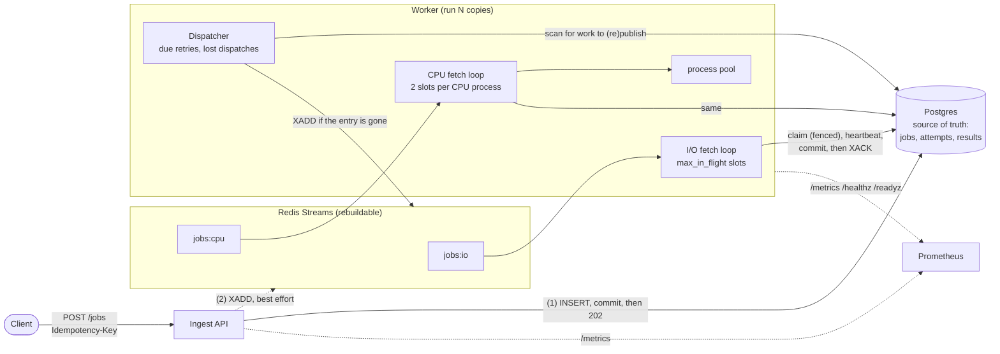

# queue-service

[](https://github.com/cardohso/queue-service/actions/workflows/ci.yml)
[](LICENSE)

A small concurrent job queue (Python 3.14, asyncio, FastAPI, Redis Streams, Postgres) built to
prove one claim with tests, not with adjectives:

> **Every accepted job reaches exactly one final state (`done` or `dead`), even when workers
> crash, Redis restarts, Postgres stops or slows down, or jobs fail. Under overload the
> service slows its producers down instead of falling over.**

## 30-second summary

- **Postgres is the source of truth; Redis Streams only dispatches.** `POST /jobs` returns
  `202` only after the job row is committed. If Redis forgets everything, a dispatcher
  re-publishes from Postgres.
- **At-least-once delivery, once-only results.** A job may *run* twice after a crash; its result
  is written once (fenced commit + unique constraint). Ack happens only after the result commits.
- **Failures are first-class:** retries with exponential back-off and full jitter, a dead-letter
  state with the reason and attempt history, crash recovery by lease expiry, graceful shutdown.
- **Back-pressure at the edge and in the worker:** `429` + `Retry-After` when the queue is deep,
  `503` when the database is overloaded, and a worker only pulls what it can start now.
- **Evidence:** 12 failure tests with real `kill -9`, real container restarts and real network
  latency; a property-based test of the invariant; benchmarks of asyncio vs threads vs processes.
  All reproducible from scripts in this repo. See [docs/RESULTS.md](docs/RESULTS.md).

## Run it (one command)

Needs Docker, `curl` and `bash`. Nothing else.

```bash
git clone https://github.com/cardohso/queue-service && cd queue-service && ./scripts/demo.sh
```

It starts Postgres, Redis, the API and 2 workers, submits 300 jobs, **`kill -9`s a worker while
it is mid-job**, waits, and checks the claim against what Postgres actually holds
(about 20 seconds after the first image build). Output from a real run:

```text
  accepted jobs (HTTP 202)        300
  done / dead                     300 / 0
  not in a final state            0
  jobs with more than 1 result    0
  done <-> result row mismatches  0
  executions started              318  (18 beyond one per job: the cost of at-least-once)
  attempts cut off by the kill    18
  time from kill to last finish   9.2 s

PASS: every accepted job reached exactly one final state, none lost, none run twice to completion.
```

The 18 extra executions are exactly the 18 jobs the killed worker held: each was taken over
after its lease expired and ran again, once. Clean up with `docker compose down -v`.

Try the API yourself while it is up:

```bash
curl -s -X POST localhost:8000/jobs -H 'content-type: application/json' \
  -H 'Idempotency-Key: my-first-job' \
  -d '{"type":"io_sleep","schema_version":1,"payload":{"duration_ms":100}}'
# {"job_id":"…","state":"queued"}   (same key again returns the same job_id)
curl -s localhost:8000/metrics | grep qs_   # Prometheus metrics; also /healthz and /readyz
```

## Architecture



Per message, a worker does: **read → claim in Postgres (fenced, starts a lease) → run with a
timeout and a heartbeat → commit the outcome in one transaction → only then ack.** Every crash
between two of those steps ends in redelivery, never in loss. The exact order, and what happens
if the process dies between any two steps, is in
[docs/DESIGN.md §5](docs/DESIGN.md#5-order-of-operations).

## The guarantees, in plain words

1. **202 means durable.** The job row is committed in Postgres before the response. If anything
   fails earlier, the client was never told "accepted" and should retry with the same
   idempotency key (same key and body returns the same job; same key with a different body is `409`).
2. **Exactly one final state.** Each accepted job ends `done` or `dead`, not both and not neither,
   whether workers crash, Redis restarts (even losing all its data), Postgres stops, freezes,
   runs out of connections or is slow.
3. **At-least-once execution, once-only results.** After a crash a job's handler runs again. A
   worker that lost its lease cannot commit over its replacement (the attempt number is a fencing
   token), and `results.job_id` is a primary key. Effects *outside* Postgres are not covered:
   handlers get the `job_id` to use as their own idempotency key.
4. **Retries are bounded and classified.** Transient errors retry with exponential back-off and
   full jitter up to `max_attempts`; permanent errors and exhausted retries become `dead` with the
   reason and per-attempt history. `qs replay` moves dead jobs back as a new epoch.
5. **A job that kills workers cannot take others down with it.** It is run alone after a crash and
   dead-lettered after its attempt budget.
6. **Overload is pushed back, not absorbed.** See [back-pressure](docs/DESIGN.md#7-back-pressure).

## What is tested, and what it showed

| Layer | What | Where |
|---|---|---|
| Unit | back-off schedule with a seeded RNG, error classification, idempotency, fences, bulkheads | `tests/` |
| Property-based | Hypothesis state machine drives the **real** worker through crashes at every step, zombies, Redis wipes, outages, duplicates, replays; checks the invariant after every step | `tests/test_properties.py` |
| Contract | the in-memory fakes are pinned to real Postgres/Redis by the same tests | `tests/integration/test_contract_*.py` |
| Failure | real `kill -9`, container restarts, toxiproxy latency, poison jobs, an open-loop flood | `tests/failure/` |

Failure-test results (median of 3 runs on a laptop; full table with spreads in
[docs/RESULTS.md](docs/RESULTS.md)). In every run no accepted job was lost and none had more than one result.

| Fault | Jobs | Extra executions | Recovery |
|---|---|---|---|
| `kill -9` a worker mid-job | 200 | 8 | 5.8 s (lease 2 s) |
| Redis killed and restarted, AOF on / **all data lost** | 400 | 0 / 0 | 0.13 s / 0.10 s |
| Postgres stopped 5 s / frozen 5 s | 300 | 16 / 5 | 1.9 s / 0.10 s |
| Postgres +100 ms latency each way | 150 | 0 | not applicable |
| Postgres out of connections | 300 | 0 | not applicable |
| Poison job (permanent, crashing child, hung CPU job, kills the worker) | 60 | 0 / 2 / 2 / 10 | only the poison is dead-lettered |
| Open-loop flood, 300 req/s for 8 s | 599 accepted | 0 | 1801 × `429`, no other status, p99 105 ms |

**Where the tests earned their keep.** Each of these was found by a test, measured, then fixed
(details and numbers in [docs/DESIGN.md](docs/DESIGN.md)):

- A poison job took bystanders down with it: up to 7 innocent jobs were dead-lettered. Fix:
  suspects run alone ([§9.1](docs/DESIGN.md#91-isolating-suspects-added-in-step-7)).
- A short DB-acquire timeout collapsed the API under 100 ms of latency (a connection takes 0.84 s
  to open). Fix: shed load by queue length, not by timeout
  ([§7](docs/DESIGN.md#7-back-pressure)).
- Crash recovery scaled with the backlog because reclaimed work competed for slots. Fix: reclaim
  before reading new work ([§9.2](docs/DESIGN.md#92-reclaimed-work-jumps-the-queue-added-in-step-7)).
- My first flood test measured my laptop, not the API (closed loop). Fix: open-loop load, latency
  from the scheduled send time.
- 4 workers exhausted Postgres's 100 connections: an unclassified error crashed handlers and
  start-up, and my pool sizing was wrong (4-8 connections beat 40). Fix: classify, retry start-up,
  size by measurement ([§7.2](docs/DESIGN.md#72-postgres-connection-budget-found-by-the-step-8-benchmark)).
- A connection killed mid-operation surfaced as an HTTP 500 (a flaky test, investigated rather than retried).
- CPU jobs queued *inside* a worker with their timeout running (p50 314-386 ms for a 10 ms job).
  Fix: one stream and slot budget per resource class
  ([§8.1](docs/DESIGN.md#81-bulkheads-one-stream-and-one-slot-budget-per-resource-class-added-in-step-8)).
- My benchmark's event-loop probe silently measured nothing (it read 0 ms). Fixed, and noted,
  because a benchmark that cannot fail is not evidence.

## Concurrency: what the benchmarks showed

Local, one laptop (Apple M1 Pro, 6 performance + 2 efficiency cores), median of 5 runs,
[all tables and spreads](docs/RESULTS.md):

| 8 workers in flight vs 1 | I/O-bound jobs | CPU-bound jobs |
|---|---|---|
| asyncio | 8.00x | 1.02x |
| threads | 7.99x | **1.00x** (p99 latency 10 ms to 295 ms) |
| processes | 8.12x | 3.43x |

That is the GIL: 8 threads do the CPU work of 1, while processes scale (3.43x here, on a machine
that was never idle). A CPU job run inline on the event loop stalled it for 233 ms (median). So:
asyncio for I/O, a process pool for CPU, never CPU on the loop. Slot counts, pool sizes and the
end-to-end scaling are measured too: [RESULTS §2](docs/RESULTS.md).

## Known limits (stated honestly)

- **Single Redis node and single Postgres node.** No high availability and no failover tested.
- **At-least-once, not exactly-once.** Effects outside Postgres need an idempotent handler.
- **No ordering and no priorities** between jobs; no scheduled (delayed) jobs except retries.
- **Admission control is soft:** it uses a sampled depth, so the queue overshoots its limit
  (peak 125 against a limit of 100 in the flood test).
- **Postgres is the throughput ceiling** (a claim and a commit per job). The laptop numbers in
  RESULTS.md are for comparing configurations, not a capacity claim.
- **Local benchmarks only**, on a laptop that was not idle (load 6 to 10 of 8 cores); the report
  says so and spreads are wide for some cells. No free-threaded Python (`3.14t`) comparison.
- **Failure tests simulate partitions** (pause, latency, kill), not a real network partition, and
  have not run on Kubernetes yet. Phase 2 (Kubernetes, KEDA, Grafana) is not started.
- **Recovery after a crash costs about one job-duration per interrupted job** (suspects re-run one
  at a time; a deliberate trade for isolation).
- **Demo settings** use a 5 s lease so recovery is visible; the default is 30 s
  ([lease trade-offs](docs/DESIGN.md#9-crash-recovery-and-the-visibility-timeout)).
- **Not a product:** no auth, TLS or multi-tenancy; three demo job types plus a fault-injection
  type that is off by default (`QS_FAULT_INJECTION`).

## Develop

```bash
uv sync                                   # Python 3.14, locked dependencies
uv run ruff check . && uv run mypy        # lint and strict types
uv run pytest -m "not integration and not failure"   # unit + property tests (seconds)
uv run pytest -m integration              # real Postgres + Redis via testcontainers (Docker)
uv run pytest -m failure -s               # the failure tests with real faults (about 3 minutes)
scripts/run_benchmarks.sh                 # regenerate every number in docs/RESULTS.md (about 25 minutes)
```

Settings are environment variables, `QS_<FIELD>` for every field in
[`config.py`](src/queue_service/config.py) (for example `QS_LEASE_S`, `QS_MAX_IN_FLIGHT`,
`QS_WORKER_DB_POOL_MAX`). CLI: `qs api`, `qs worker`, `qs replay --all-dead`.
On some Docker Desktop setups testcontainers needs `TESTCONTAINERS_RYUK_DISABLED=true`.

## Layout

```text
src/queue_service/   api, ingest, worker, store (Postgres state machine), broker (Redis),
                     executor (asyncio + process pool), retry, isolation, admission, metrics
tests/               unit, property, contract, integration, failure (tests/failure/)
bench/               executor benchmark, end-to-end benchmark, CPU-slot benchmark, report
docs/DESIGN.md       every decision and its trade-off, including what the tests changed
docs/RESULTS.md      generated from results/*.json by bench/report.py (do not edit)
```

## Licence

MIT, see [LICENSE](LICENSE).
