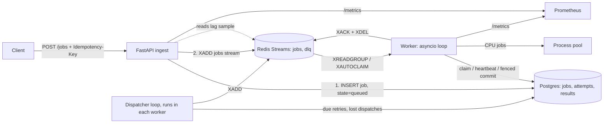

# DESIGN

Status: **reviewed** (step 1 done, 2026-11-11). Nothing here is implemented yet. All owner
decisions are made; items marked **[VERIFY]** must be checked against current
library/Redis docs in step 2 before relying on them.

## 1. The claim

> Every accepted job reaches exactly one final state (`done` or `dead`), even when
> workers crash, the broker restarts or jobs fail; and under overload the service
> slows producers (429) instead of falling over.

Precise wording we can defend:

- **Accepted** = `POST /jobs` returned `202`. A `202` is sent only after the job row is
  committed in Postgres. Anything that failed before that point was never accepted
  (client got 5xx/429 and retries with the same idempotency key).
- **Delivery** is at-least-once. A handler can **run** more than once.
- **Effects in Postgres** happen once (fenced commit + unique constraint on `job_id`).
  Effects outside Postgres (HTTP calls, emails) are *not* covered; handlers receive
  `job_id` to use as their own idempotency key. This is "effectively-once", not
  exactly-once.
- **No ordering guarantee** between jobs.

## 2. Main change from the proposed design: Postgres is the source of truth

The proposal had Redis as the queue and Postgres only for results. That leaves two holes:

1. **Redis restart can lose accepted jobs.** With `appendfsync everysec` Redis can lose
   ~1 s of writes on a crash; with no persistence it loses everything. A `202` would
   then be a lie, and the "restart Redis" test would fail (or pass only because of a
   config flag).
2. **Idempotency keys stored in Redis vanish on the same restart**, so a client retry
   creates a second job.

**Proposal:** the `jobs` table in Postgres holds every job and its state. Redis Streams
is the *dispatch channel*: fast fan-out, consumer groups, pending-entry list (PEL),
`XAUTOCLAIM`. If Redis loses data, a **dispatcher** re-publishes from Postgres. The
invariant is then checkable with one SQL query.

> Interview version: "Two stores can't be updated atomically, so I picked one to be
> the truth and made the other rebuildable. Redis can forget anything and the system
> recovers, at the cost of duplicate deliveries, which the fenced, idempotent commit
> absorbs."

Alternatives considered:

| Option | Pro | Con |
|---|---|---|
| A. Redis = truth, `appendfsync always` | Simplest | Durability rests on one Redis flag; idempotency still fragile; DLQ/PEL lost if AOF is off |
| **B. Postgres = truth, Redis = dispatch (recommended)** | Survives total Redis loss; invariant is one query; keeps Streams/KEDA learning goals | More moving parts (dispatcher, leases) |
| C. Postgres only (`SELECT … FOR UPDATE SKIP LOCKED`) | Ack and commit in one transaction: simplest correct design | Drops Redis Streams, consumer groups and the KEDA Redis scaler, which are part of the CV goal |

**Decided (2026-11-11): B.** Postgres is the source of truth; Redis is a rebuildable
dispatch channel.

## 3. Architecture



## 4. Job state machine

```
            claim                     fenced commit
 queued ─────────────▶ running ───────────────────────▶ done      (terminal)
   ▲  ▲                 │  │  │
   │  │ release         │  │  └── permanent error or attempts exhausted ──▶ dead (terminal)
   │  └─────────────────┘  │
   │   (graceful shutdown) │ transient error
   │                       ▼
   └──── dispatcher ── retry_wait (next_attempt_at = now + backoff)

 running with expired lease ── claim by another worker ──▶ running (attempt n+1)
 dead ── replay command ──▶ queued (logged as a new "epoch")
```

Tables (sketch):

- `jobs(id uuid pk, idempotency_key text unique null, type, schema_version, payload jsonb,
  state, attempts int, max_attempts int, lease_owner, lease_until, next_attempt_at,
  dispatched_at, epoch int, created_at, updated_at)`
- `job_attempts(job_id, epoch, attempt, worker_id, started_at, finished_at, outcome, error_class, error)`
- `results(job_id pk, epoch, result jsonb, committed_at)`

**Fencing.** `attempts` doubles as a fencing token. Every write after the claim says
`WHERE id=$1 AND state='running' AND attempts=$n AND lease_owner=$me`. A "zombie" worker
(paused by GC, network partition, laptop sleep) whose lease expired and was taken over
gets 0 rows and discards its result.

> Interview version: "A lease alone isn't enough, because the old holder doesn't know
> it lost the lease. Fencing makes the database reject its write, so at most one attempt
> can commit."

**Replay vs. "exactly one final state".** Replay moves `dead → queued` on purpose. The
invariant is stated per epoch: each `(job_id, epoch)` ends in exactly one final state;
replay is an explicit, audited new epoch.

## 5. Order of operations

### 5.1 Ingest (`POST /jobs`)

| # | Step | If the process dies right after it |
|---|---|---|
| 1 | Validate payload (pydantic, discriminated on `type` + `schema_version`) | Nothing written. Client gets error, retries. |
| 2 | `INSERT … ON CONFLICT (idempotency_key) DO NOTHING RETURNING id`; if conflict, `SELECT` existing and return it | Not committed → not accepted. |
| 3 | `COMMIT` | **Accepted** but not dispatched, and the client may not have seen the 202. Dispatcher publishes it after `dispatch_grace` (e.g. 5 s). Client retry with the same key returns the same job. |
| 4 | `XADD jobs * job_id … epoch …`; `UPDATE dispatched_at` (best-effort) | Duplicate dispatch possible (dispatcher may publish again). Harmless: claim is conditional. |
| 5 | Return `202 {job_id}` | — |

Without an idempotency key, a client retry after a lost 202 creates a second job. That is
correct behaviour (we can't know) and is documented.

### 5.2 Worker, per message

| # | Step | If the worker dies right after it | Recovery |
|---|---|---|---|
| 1 | `XREADGROUP COUNT=free_slots` (message now in this consumer's PEL) | Message in PEL, job still `queued` | `XAUTOCLAIM` after `min_idle`, or dispatcher re-publishes |
| 2 | **Claim** in PG: `UPDATE … SET state='running', attempts=attempts+1, lease_until=now()+ttl, lease_owner=me WHERE id=$1 AND epoch=$e AND (state='queued' OR (state='running' AND lease_until<now())) RETURNING attempts`; insert `job_attempts` row. 0 rows → stale duplicate → go to step 6 | Job `running`, lease ticking | Lease expires → `XAUTOCLAIM` → re-claim as attempt n+1. **Crash counts as an attempt**, so a job that kills the worker is dead-lettered after `max_attempts` crashes instead of crash-looping forever. |
| 3 | Execute with timeout; heartbeat every `ttl/3` extends `lease_until` (fenced) and resets PEL idle (`XCLAIM … JUSTID` to self) | Work may be half done; nothing committed | Same as above. Handler runs again (at-least-once). |
| 4 | **Fenced commit**, one transaction: outcome → `done` + `INSERT results`, or `retry_wait` + `next_attempt_at`, or `dead` + reason. Attempt row finished. 0 rows → we were fenced out, discard | Outcome durable; message still in PEL | Redelivery hits step 2 with 0 rows (state no longer claimable) → ack. One duplicate *delivery*, zero duplicate effects. |
| 5 | If `dead`: `XADD dlq` (observability copy; may duplicate) | DLQ copy may be missing | DLQ truth is `state='dead'`; `dlq` stream is rebuildable |
| 6 | `XACK` + `XDEL` (or `XACKDEL` **[VERIFY]** Redis 8.2+) | — | — |

Rule: **never ack before the outcome is committed.** Every crash window therefore ends in
redelivery, never loss; redelivery is made safe by the conditional claim and fenced commit.

### 5.3 Dispatcher (a loop inside each worker; safe to run N copies)

Every `tick` (e.g. 500 ms), in one transaction with `FOR UPDATE SKIP LOCKED LIMIT k`:

- `retry_wait` rows with `next_attempt_at <= now()` → `state='queued'`, then `XADD`.
- `queued` rows with `dispatched_at` older than `dispatch_grace` (or null and
  `created_at` older than it) → `XADD`, bump `dispatched_at`.

This one loop covers: API crash between commit and `XADD`, Redis data loss, stream
trimmed by mistake, and delayed retries. Redis Streams has no delayed delivery, and
sleeping inside the worker would hold an in-flight slot and the PEL entry.

## 6. Retries

- Error classes: `TransientError` (timeouts, connection errors, 5xx from dependencies,
  `BrokenProcessPool`) and `PermanentError` (validation, unknown type, handler raises
  permanent). Unknown exceptions: **transient**, so a bug doesn't silently dead-letter
  good jobs, but bounded by `max_attempts`. **Decided (2026-11-11): unknown → transient.**
The dead-letter record keeps the exception type, so a bug shows up clearly in the DLQ.
- Back-off: `delay = random.uniform(0, min(cap, base * 2**(attempt-1)))` (AWS "full
  jitter"). Computed with an injected `Clock` and `Random` so tests are exact.
- **Infrastructure errors don't burn attempts.** If Postgres is down, the worker can't
  claim (step 2) so attempts don't increase; it pauses fetching (circuit breaker:
  open → half-open probe) instead of pulling messages it can't process.
- Dead-letter record: reason, error class, full `job_attempts` history.
- `qs replay --job-id … | --all-dead --since …`: new epoch, attempts reset, logged.

> Interview version: "Full jitter spreads retries uniformly so a burst of failures
> doesn't come back as a synchronized burst. Infra outages pause consumption rather than
> consuming retry budget, otherwise a 2-minute DB blip would dead-letter healthy jobs."

## 7. Back-pressure

**Inside the worker.** `max_in_flight` = semaphore size. The fetch loop asks for exactly
`free_slots` messages and blocks when there are none. **No extra in-memory buffer:** a
message read into a buffer is already in our PEL, so buffering only adds messages that a
crash strands until `min_idle`. The broker *is* the buffer.

> Interview version: "Pull-based consumers get back-pressure for free if they only pull
> what they can start now. A local prefetch buffer improves throughput slightly but
> widens the crash blast radius, so I left it out."

**At the edge.** A background sampler reads consumer-group lag + pending
(`XINFO GROUPS`, Redis 7+) every 500 ms. If `lag > max_lag` → `429` with
`Retry-After = clamp(ceil(lag / recent_throughput), 1, 30)`. Using the same signal KEDA
scales on keeps admission and autoscaling consistent in phase 2. If Postgres is
unavailable or the DB pool can't give a connection within 200 ms → `503`. Admission is
approximate (sampled), so the limit is soft; the test asserts "bounded", not "exact".

If Redis is down but Postgres is up, the API still **accepts** (commit, `XADD` fails,
dispatcher catches up later) up to a backlog limit counted in Postgres.
**Decided (2026-11-11): keep accepting while Redis is down.** Acceptance depends only on
the durable store; a Redis outage delays work but doesn't reject producers.

## 8. Worker pool

- I/O jobs: asyncio tasks under the semaphore, `asyncio.timeout()`. Handlers must be
  cancellation-safe (no swallowing `CancelledError`).
- CPU jobs: process pool. Two traps in stdlib `ProcessPoolExecutor`:
  1. **Timeout doesn't stop the work.** Cancelling the awaiting future leaves the child
     process running; a stuck job keeps a pool slot forever.
  2. **One child crash breaks the whole pool** (`BrokenProcessPool`), failing every
     in-flight CPU job.
  Plan: use `pebble.ProcessPool` (per-task timeout kills the child) **[VERIFY]** 3.13/3.14
  support, or a small wrapper that recycles the pool on timeout/break. In-flight CPU jobs
  on a broken pool are classified transient. Pool sized to cores, separate semaphore from I/O.
- Event-loop lag: a task does `await asyncio.sleep(0.1)` and records the overshoot as a
  histogram. Test: run CPU jobs in-loop vs. in pool, assert p99 lag difference.

## 9. Crash recovery and the visibility timeout

`min_idle` (for `XAUTOCLAIM`) = `lease_ttl` (e.g. 30 s), heartbeat every 10 s.

| Shorter timeout | Longer timeout |
|---|---|
| Faster recovery after a crash | Slower recovery (up to `ttl` + scan interval) |
| More false reclaims of slow-but-alive jobs → duplicate execution | Fewer duplicates |
| Heartbeat must be frequent | Stuck jobs hold slots longer |

The heartbeat breaks the trade-off for *alive* workers: a live job's lease keeps
extending, so `ttl` only needs to cover "time to notice a dead worker", not "longest
job". Duplicates then come only from real crashes and pauses longer than `ttl`, and the
fence makes those harmless.

## 10. Graceful shutdown (SIGTERM)

1. Stop fetching (readiness → 503 so the k8s Service stops routing; API only).
2. Wait for in-flight jobs up to `drain_deadline` (e.g. 25 s).
3. For jobs still running: cancel; **release** = fenced tx `state='queued', attempts=attempts-1`
   (shutdown isn't the job's fault), `XADD` new message, then `XACK` old one.
   Crash between `XADD` and `XACK` → duplicate delivery, harmless.
4. Close pools, exit 0. Phase 2: `terminationGracePeriodSeconds = drain_deadline + 5`.

A `kill -9` skips all of this; that path is covered by §9.

## 11. Observability (needed by phase 2)

Prometheus: `queue_lag`, `queue_pending`, `jobs_in_flight{kind}`, `jobs_total{outcome}`,
`job_duration_seconds` histogram, `job_retries_total{error_class}`, `dead_letter_total`,
`event_loop_lag_seconds` histogram, `duplicate_deliveries_total`, `fenced_writes_total`,
`dispatcher_republished_total`, `http_429_total`. JSON logs (structlog) with `job_id`,
`epoch`, `attempt`, `worker_id`. `/healthz` = process alive; `/readyz` = PG + Redis
reachable and not draining.

## 12. Testing strategy

Code is split behind ports (`Broker`, `Store`, `Clock`, `Executor`) so the same core runs
against fakes and real services.

1. **Unit:** back-off schedule with fake clock + seeded RNG; error classification;
   idempotent ingest; fence rejects stale attempt.
2. **Property-based (Hypothesis `RuleBasedStateMachine`):** rules = submit, deliver,
   handler succeed/transient/permanent, crash worker at step k, Redis wipe, advance
   clock, replay. Runs the *real* core against in-memory fakes. Invariant checked after
   every step and at the end (after advancing the clock past all retries): every accepted
   `(job, epoch)` is in exactly one terminal state; `results` has ≤ 1 row per job;
   `done ⇔ result exists`.
3. **Contract tests:** the same test suite against `FakeBroker` and real Redis, so
   fakes can't drift from real `XAUTOCLAIM`/PEL semantics (this is how property tests
   "pass for the wrong reason").
4. **Integration:** testcontainers (Redis, Postgres) in CI.
5. **Failure tests** (each reports duplicates and recovery time, then checks the invariant
   with SQL):
   - `kill -9` worker mid-job: job type `block_until_released` emits a "started" event
     (Redis key / Postgres row); test waits on the event, kills, then releases.
     No sleeps.
   - Restart Redis, with AOF on **and** with persistence off (total loss).
   - Postgres slow (`toxiproxy` latency) and down (stop container).
   - Poison: permanent-error payload, and a payload that crashes the child process.
   - Flood: N concurrent clients; assert 429s appear, p99 of accepted stays bounded,
     no 5xx except 503 during injected outages, invariant holds.
6. **Benchmarks:** asyncio vs threads vs processes × I/O vs CPU jobs × worker count;
   ≥ 3 runs, report median and min–max; record CPU, RAM, OS, Python build. Optional
   extra: Python 3.14 free-threaded build (`3.14t`) to show the GIL effect disappearing
   for CPU-bound threads. **[VERIFY]** dependency wheels for 3.14t.

Determinism rules: fake clock for time logic; events instead of sleeps; fixed Hypothesis
seed in CI plus a nightly random-seed job; a flaky test is debugged, never retried away.

## 13. Known limits (to state in README)

- Single Redis node, single Postgres node; no HA.
- At-least-once delivery; once-only effects only inside Postgres.
- No ordering between jobs; no priorities.
- Admission control is sampled, so the lag limit is soft.
- Benchmarks are local, one machine.
- Postgres is the throughput ceiling (claim + commit = 2 transactions per job).
  Expected to be fine for a demo (thousands/s); measured in RESULTS.md, not assumed.

## 14. Stack

Python **3.14** (decided 2026-11-11; fall back to 3.13 only if step 2 finds a missing wheel
for `asyncpg`, `redis-py` or `pebble`); optional `3.14t` free-threaded benchmark;
FastAPI, pydantic v2, `redis-py` asyncio, `asyncpg`, `prometheus-client`, `structlog`;
uv, ruff, mypy (strict), pytest, pytest-asyncio, Hypothesis, testcontainers, toxiproxy;
Docker Compose; GitHub Actions; gitleaks for secret scan.
